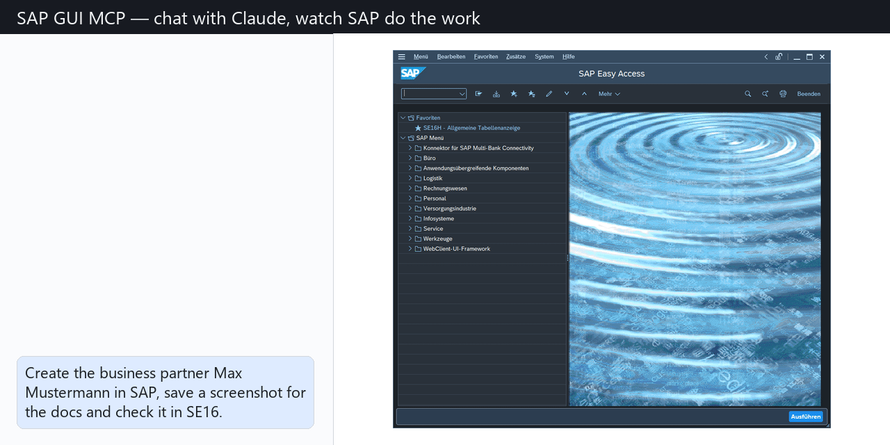
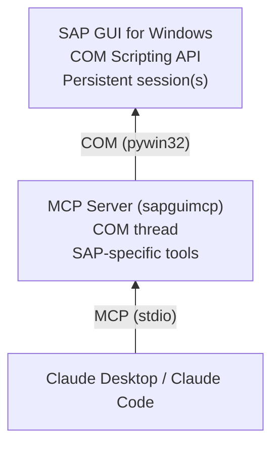

# SAP GUI MCP Server

[](https://github.com/Hochfrequenz/sapgui.mcp/actions)
[](https://github.com/Hochfrequenz/sapgui.mcp/actions)
[](https://github.com/Hochfrequenz/sapgui.mcp/actions)
[](https://github.com/Hochfrequenz/sapgui.mcp/actions)

An MCP (Model Context Protocol) server for SAP automation.
It allows you to control SAP through Claude Desktop, Claude Code, or [opencode](https://opencode.ai) - via **SAP GUI for Windows** (COM scripting).

> [!IMPORTANT]
> **SAP Web GUI support moved** to the separate project [sapwebgui.mcp](https://github.com/Hochfrequenz/sapwebgui.mcp). [v0.20.0](https://github.com/Hochfrequenz/sapgui.mcp/releases/tag/v0.20.0) was the last release of this project with both backends. Releases after v0.20.0 only drive SAP GUI for Windows. If you use SAP Web GUI (browser), macOS or Linux, use [sapwebgui.mcp](https://github.com/Hochfrequenz/sapwebgui.mcp) instead.

Because it drives the real SAP UI (not a headless API), it is especially well-suited for **end-to-end testing**, **visual validation**, and **capturing screenshots for documentation**.
The MCP server works with both SAP R/3 and S/4.



> [!TIP]
> **Try it yourself:** this demo is a skill that ships with this repository -
> clone it (or copy [`.claude/skills/readme-demo/`](.claude/skills/readme-demo) into your project), then ask
> your agent to _run the readme demo_ (or invoke `/readme-demo` in Claude
> Code) - it logs into your system, creates a business partner, screenshots
> it, and verifies it in SE16. It needs SAP GUI for Windows
> with scripting enabled, because the screenshots are saved via `sap_run_script`.

### Windows only

This server uses the SAP GUI COM scripting API. It is Windows-only and single-threaded at its core, but well tested. It uses [sapsucker](https://github.com/Hochfrequenz/sapsucker) for typed SAP GUI Scripting access.
This means that after your agent clicks a button, the MCP server has to wait until the GUI responds, which takes some milliseconds that can add up for batch processes.
The Web GUI driver, which is OS-independent and can run concurrent workflows in several browser tabs, lives in [sapwebgui.mcp](https://github.com/Hochfrequenz/sapwebgui.mcp).

### Pairing with other MCPs

You can easily pair this GUI MCP with e.g. an ADT MCP like [`aibap.mcp`](https://github.com/Hochfrequenz/aibap.mcp).
ADT MCPs and this GUI MCP complement each other in a two-agent vibe-coding setup: one agent writes ABAP via ADT, while a second agent drives this server to test the generated code in the real SAP UI, captures screenshots, and reports failures back.

### Batch scripting: the same click journey n times for the token cost of one tool call

> [!TIP]
> **Save tokens with `sap_run_script`!** 🚀 Instead of dozens of back-and-forth tool calls, the AI agent can write and execute a single Python script that loops, branches, and collects results - all in one shot. You just describe what you need; the agent generates the script automatically. Perfect for repetitive workflows like reading 50 table rows or bulk-updating fields. Runs in a secure sandbox against the SAP GUI COM API. See [Capabilities](#capabilities).

### Language-specific behaviour for some transactions

The core of this MCP is _not_ language-specific, meaning it generally works with any SAP logon language.
However, there is also built-in support for specific transactions like `SE16` or `ST22`.
These transaction-specific tools only work for certain logon languages, because the MCP server relies on button or column labels, which vary by language.
We support English (`EN`), German (`DE`) and Italian (`IT`).
A new language can also start with a small "core" language pack (popup handling and key names only): you can then log on in it and use the language-independent tools, while the transaction-specific tools fail with a clear error, and `sap_login` reports this as `language_support: "core"`. No core pack is shipped yet; [`ADDING_A_LANGUAGE.md`](src/sapguimcp/lang/ADDING_A_LANGUAGE.md) explains how to add one.

### Under the hood

Are you a developer?
Read [ARCHITECTURE.md](ARCHITECTURE.md) for codebase structure, request flow diagrams, and how to add new transaction tools.
The [Development Setup](#development-setup-from-source) section covers running from source.

## Setup

Setup has three steps (plus one-time prerequisites): download the executable, create your SAP credentials file (`systems.json`, optionally using `${env:VAR}` placeholders to reference environment variables), and register the MCP server with your AI client.

> [!NOTE]
> **Why a separate credentials file?** Most MCP servers put SAP credentials directly in the per-project MCP config (`env` block), which means re-entering them for every project.
> Here, credentials and SAP settings live in a single shared file (`systems.json`) that all Hochfrequenz SAP MCP servers read automatically - so this server and [`aibap.mcp`](https://github.com/Hochfrequenz/aibap.mcp) both work with the same credentials without duplication.
> You **can** store credentials in plain text, but you can also refer to an environment variable.

**Where to register the MCP server:**

- **Claude Code** - register once with `claude mcp add --scope user` (recommended) or per project in `.mcp.json`. [Step 3](#step-3-configure-your-mcp-client) shows both.
- **Claude Desktop** - `claude_desktop_config.json`; open it via Settings → Developer → Edit Config (usually `%APPDATA%\Claude`).
- **[opencode](https://opencode.ai)** - `opencode.json` in the project root.

> [!WARNING]
> **Special characters in passwords stored in a `.json` file:** If your SAP password contains `"` or `\` characters, you must escape them in the JSON config files: `"` becomes `\"` and `\` becomes `\\`. For example, `pass"word` becomes `"pass\"word"` and `do\main` becomes `"do\\main"`. Unescaped special characters will silently break the JSON: a broken MCP client config keeps the server from starting, and a broken `systems.json` makes `sap_login` fail with a config error.

> [!TIP]
> **Windows file extensions:** If file extensions are hidden in Windows Explorer, creating `.mcp.json` via right-click → New → Text File will produce `.mcp.json.txt` (or `.mcp.json.json` if you rename). Make sure "File name extensions" is checked in Explorer's View tab, then rename the file.

### Prerequisites

Ask your SAP basis team for the server-side setting early - it is the only step you cannot do yourself.

- SAP GUI for Windows installed (standard path - the server finds it automatically via Windows registry)
- SAP GUI Scripting enabled (one-time setup, see below)

<details>
<summary>Enable SAP GUI Scripting (one-time)</summary>

**Server side** (requires admin/basis team):

- Transaction `RZ11` → parameter `sapgui/user_scripting` → set to `TRUE`
- Dynamic parameter - no server restart needed, but users must re-login (close and reopen SAP GUI)

**Client side** (your PC):

1. Open SAP Logon or any SAP GUI session
2. Go to **Options** (via menu bar, tray icon, or press **Alt+F12** in a session)
3. Navigate to **Accessibility & Scripting → Scripting** (DE: **Barrierefreiheit & Skripting → Skripting**)
4. Check **"Enable Scripting"** (DE: **"Skripting aktivieren"**)
5. Uncheck **"Notify when a script attaches to SAP GUI"**
6. Uncheck **"Notify when a script opens a connection"**

> [!IMPORTANT]
> The two notification checkboxes **must** be unchecked. If left checked, every COM connection triggers a modal popup that blocks automation.

</details>

### Step 1: Download the executable

Download `sapgui_mcp_windows_<version>.exe` from [GitHub Releases](https://github.com/Hochfrequenz/sapgui.mcp/releases/latest). It is a single file - no Python needed. Do not use the `sapgui_mcp_windows_with_remote_logging_<version>.exe` variant: it sends logs to a remote log service and is meant for the maintainers. To verify the download, run `Get-FileHash .\sapgui_mcp_windows_<version>.exe` in PowerShell and compare the hash with `checksums.txt` from the same release.

#### Smart App and other Security Tools

> **Tip**
>
> **Windows blocks the `.exe`?** Windows may flag an executable as downloaded from another computer.
> If you trust the file downloaded from our GitHub Releases, right-click it → **Properties** (**Eigenschaften**) → **General** (**Allgemein**).
> Under **Security** (**Sicherheit**), check **Unblock** (**Zulassen**), then **Apply** (**Übernehmen**) and try again.
>
> The checkbox only appears when Windows has marked the file as downloaded from another computer. This removes that download block; it does not override Smart App Control.
> If Smart App Control still blocks execution, contact your IT administrator rather than disabling protection.


### Step 2: Create the SAP config file (`systems.json`)

This file holds your SAP credentials and is shared with [aibap.mcp](https://github.com/Hochfrequenz/aibap.mcp) - configure it once and all Hochfrequenz SAP MCP servers will use it.

On **Windows**, open Windows Explorer and paste this into the address bar:

```
%USERPROFILE%\.config\sap-mcp
```

Create the folder if it doesn't exist, then create a file called `systems.json` inside it.

There are two distinct identifiers per system - don't mix them up:

| Concept                                       | Example                                    | Where it's used                                                  |
| --------------------------------------------- | ------------------------------------------ | ---------------------------------------------------------------- |
| **System key** (dictionary key)               | `"dev"`, `"qa"`                            | `sap_login(system_key="qa")` - selects which system to log into  |
| **SAP Logon entry** (`connection_name` field) | `"DEV S/4HANA"`, `"DEV - ERP Development"` | Must match the **bold description** in the SAP Logon pad exactly |

The SAP Logon entry is _not_ the 3-character System ID (SID):

| What you see in SAP Logon | `connection_name` value   | NOT this (SID) |
| ------------------------- | ------------------------- | -------------- |
| **DEV S/4HANA**           | `"DEV S/4HANA"`           | ~~`"XYZ"`~~    |
| **DEV - ERP Development** | `"DEV - ERP Development"` | ~~`"DEV"`~~    |

If the `connection_name` doesn't match exactly, you'll get _"SAP Logon connection entry not found"_.

```json
{
    "default_system": "dev",
    "systems": {
        "dev": {
            "connection_name": "DEV S/4HANA",
            "host": "https://your-sap-system:44300",
            "client": "100",
            "user": "your_username",
            "password": "your_password",
            "language": "DE"
        }
    }
}
```

> [!NOTE]
> This server connects through `connection_name` (the SAP Logon entry); it does not use `host` or `tls_skip_verify`. The shared config format still requires `host`, so enter your system's HTTPS URL - other tools that read `systems.json`, such as [`aibap.mcp`](https://github.com/Hochfrequenz/aibap.mcp), use it. `tls_skip_verify` matters only to those tools.

> [!IMPORTANT]
> After editing `systems.json`, restart Claude Desktop, Claude Code, or opencode for the changes to take effect.

> [!TIP]
> **Don't want your password sitting in the file?** A system's string fields - `connection_name`, `host`, `client`, `user`, `password`, `language`, `oauth2_client_id` - may reference an environment variable instead, using `${env:VAR}`:
>
> ```json
> "user": "${env:SAP_DEV_USER}",
> "password": "${env:SAP_DEV_PASSWORD}"
> ```
>
> The file then holds only structure - which systems exist, their hosts and connection names - so it is safe to commit and share with your team, while the credentials come from your environment or password manager. If a referenced variable is unset or empty, the first tool call that needs a credential - `sap_login`, for instance - fails with an error naming the variable, rather than logging in with an empty password.

See [sap-mcp-config](https://github.com/Hochfrequenz/sap-mcp-config) for the complete field reference - all optional fields, validation rules, YAML support, `${env:VAR}` placeholder rules, and a visual guide to finding your `connection_name` in SAP Logon.

### Step 3: Configure your MCP client

> [!TIP]
> Note the full path to the downloaded `.exe`. For example, if you saved `sapgui_mcp_windows_<version>.exe` to your Downloads folder, the path is `C:/Users/YourName/Downloads/sapgui_mcp_windows_<version>.exe`. Always use forward slashes (`/`) in JSON, not backslashes (`\`).

#### Claude Desktop

Add to `claude_desktop_config.json`. To open the file: press **Win+R**, type `%APPDATA%\Claude`, press Enter. If `claude_desktop_config.json` does not exist, create a new text file with that exact name (make sure it ends in `.json`, not `.json.txt`).

```json
{
    "mcpServers": {
        "sap-desktop": {
            "command": "C:/path/to/sapgui_mcp_windows_<version>.exe"
        }
    }
}
```

#### Claude Code

**Recommended: register once for all projects (user scope).** Run this in PowerShell:

```powershell
claude mcp add --scope user sap-desktop '--' C:/path/to/sapgui_mcp_windows_<version>.exe
```

Together with `systems.json`, this is all Claude Code needs - no `.mcp.json` in any project folder.

Optional server settings (see [environment variables](#environment-variables-server-specific)) go as `-e` options between the server name and `'--'`:

```powershell
claude mcp add --scope user sap-desktop -e GITHUB_PAT=your_github_pat -e OUTPUT_DIR=C:/sap-output '--' C:/path/to/sapgui_mcp_windows_<version>.exe
```

Two details matter:

- **Keep the server name (`sap-desktop`) before `-e`.** The `-e` option accepts several values, so a name placed after it is read as a second environment variable and the command fails with `error: missing required argument 'commandOrUrl'`.
- **Keep the quotes around `'--'`.** If Claude Code was installed through npm, `claude` is a PowerShell script, and PowerShell silently drops an unquoted `--` before passing the arguments on. `-e` then swallows the `.exe` path and the command fails with the same error. This works in PowerShell, bash and zsh (in bash or zsh, `'--'` and `--` are equivalent). In cmd.exe, single quotes are not quoting characters, so write a plain `--` instead.

If Claude Code still starts an old or broken registration instead of the global one, see [Claude Code ignores the global registration](#claude-code-ignores-the-global-registration).

**Alternative: per project.** Add to `.mcp.json` in your project root:

```json
{
    "mcpServers": {
        "sap-desktop": {
            "command": "C:/path/to/sapgui_mcp_windows_<version>.exe"
        }
    }
}
```

#### opencode

Add to `opencode.json` in your project root:

```json
{
    "$schema": "https://opencode.ai/config.json",
    "mcp": {
        "sap-desktop": {
            "type": "local",
            "command": ["C:/path/to/sapgui_mcp_windows_<version>.exe"],
            "enabled": true
        }
    }
}
```

> [!TIP]
> In `opencode.json`, you can use either forward slashes (`C:/path/to/...`) or double-escaped backslashes (`C:\\path\\to\\...`) in the `command` path. Single backslashes will break the JSON silently.

Optional server settings ([environment variables](#environment-variables-server-specific)) go in an `"env": { ... }` block next to `"command"` in `claude_desktop_config.json` and `.mcp.json`, and in an `"environment": { ... }` block in `opencode.json`. With `claude mcp add`, a value passed with `-e` (such as a PAT) ends up in your shell history.

### Multi-system access

Multi-system support is built into `systems.json` - add multiple systems and the LLM can switch between them:

**How it works:**

1. `sap_list_connections` returns both configured systems (from `systems.json`) and SAP Logon entries (from `SAPUILandscape.xml`).
2. `sap_login(system_key="qa")` logs into a specific system using credentials from `systems.json`.

**Configuration:** Add multiple systems to your `systems.json`. The **dictionary key** (e.g. `"dev"`, `"qa"`) is the `system_key` you pass to `sap_login`. The `connection_name` field must match the SAP Logon entry description exactly:

```json
{
    "default_system": "dev",
    "systems": {
        "dev": {
            "connection_name": "DEV S/4HANA",
            "host": "https://dev-sap:44300",
            "client": "100",
            "user": "dev_user",
            "password": "dev_pass",
            "language": "DE"
        },
        "qa": {
            "connection_name": "QA System",
            "host": "https://qa-sap:44300",
            "client": "200",
            "user": "qa_user",
            "password": "qa_pass",
            "language": "EN"
        }
    }
}
```

When `sap_login(system_key="qa")` is called, it looks up `"qa"` in `systems.json`, reads the credentials, and uses the `connection_name` field (`"QA System"`) to open the matching SAP Logon entry. If the system key is not found, an error is returned listing the available keys.

### Verify the setup

Before your first prompt, check that the MCP server starts correctly. Open PowerShell and run:

**Claude Code:**

```
claude mcp list
```

Expected output:

```
sap-desktop: C:/path/to/sapgui_mcp_windows_<version>.exe ✓ Connected
```

**opencode:**

```
opencode mcp list
```

Expected output:

```
● ✓ sap-desktop connected
```

If you see `✗ Failed` or `✗ failed`, the most common cause is a wrong path to the `.exe` in your config file. Double-check the path and that the file exists there. Run `opencode mcp debug sap-desktop` for more detail.

For Claude Code, with a user-scope registration there is no config file to edit: `claude mcp get sap-desktop` shows the registered path, and to change it (for example after downloading a new version), run `claude mcp remove sap-desktop -s user` and add the server again.

> [!TIP]
> **Getting started:** Restart Claude Desktop, Claude Code, or opencode, then try: _"Log me into SAP"_ or _"Run transaction SE16"_. SAP GUI will open automatically if it is not already running.

## Development Setup (from source)

For contributors who want to run from source. Prerequisites: Python 3.11+, [uv](https://docs.astral.sh/uv/getting-started/installation/), and SAP GUI for Windows with scripting enabled (see [Prerequisites](#prerequisites)).

```bash
git clone https://github.com/Hochfrequenz/sapgui.mcp.git
cd sapgui.mcp
uv sync --group dev
```

Run tools through `uv run ...` (not a bare `pytest` from an older venv). Unit tests and linters:

```bash
uv run --group tests python -m pytest unittests/ -m "not integration"   # unit tests only
uv run --group linting ruff check .                                      # code quality
uv run --group linting ruff format --check .                             # check formatting
```

See [CONTRIBUTING.md](CONTRIBUTING.md) for the full workflow.

To run the server from source, register the `run-sapgui-mcp-server` script of your virtual environment the same way as the executable (see [Step 3](#step-3-configure-your-mcp-client)), for example:

```powershell
claude mcp add --scope user sap-desktop '--' C:/path/to/sapgui.mcp/.venv/Scripts/run-sapgui-mcp-server.exe
```

`GITHUB_PAT` (optional) is only needed for `log_feedback` (creates GitHub issues) and abapGit operations. See the [environment variables](#environment-variables-server-specific).

## Capabilities

<a id="capabilities"></a>
<a id="available-tools"></a>
<a id="desktop-com-tools-desktop-backend-only"></a>

Your AI client automatically discovers all individual tools and their schemas dynamically upon connection. At a high level, the server gives your agent:

- **Drive Any SAP Transaction** — Execute transaction codes, fill form fields, click buttons, navigate tabs, read and interact with ALV grids and tables, edit cells of editable ALV grids (`sap_modify_cell`, read back after the write), and handle modal popups and status bar messages.
- **Transaction Shortcuts** — Built-in workflows for common developer and basis tasks: query tables (SE16/SE16N), inspect transports (SE09/SE10), search background jobs (SM37), inspect short dumps (ST22), query application logs (SLG1), maintain table views (SM30), and look up Data Dictionary objects (SE11).
- **High-Performance Scripting (`sap_run_script`)** — For bulk operations or complex multi-step workflows, the agent can write and run sandboxed Python scripts against the SAP GUI COM API in a single round-trip instead of dozens of tool calls. The sandbox contract is exposed via `sandbox://sap_run_script`.
- **Tree Navigation (`sap_tree_read`, `sap_tree_expand`, `sap_tree_select`, `sap_tree_activate`)** — Read or search the already-loaded nodes of any tree control (SPRO IMG, SE80 object tree, SM34 navigation tree, docking-container trees) with a node cap and ancestor paths, then expand or collapse a folder, select a node, or double-click a node or click a link item in it. Reading never expands or selects; only the activate tool can navigate or start an action.
- **Visual Validation & Screenshots** — Capture screenshots of any SAP screen for documentation, E2E test verification, or human-in-the-loop inspection.
- **Offline Catalogs** — Search transaction codes, tables, classes, and function modules instantly without an active SAP connection.
- **abapGit & Source Code** — Pull abapGit repositories and inspect ABAP report source code. Pulls use the [`Z_ABAPGIT_PULL_MCP_SHORTCUT`](https://github.com/Hochfrequenz/Z_ABAPGIT_PULL_MCP_SHORTCUT) report on the SAP system. For private repositories, set `GITHUB_PAT` or `ABAPGIT_PAT`. `sap_abapgit_pull` takes an optional `branch` (e.g. `main`, `feature/x`): it switches the registered repository to that branch persistently (kept only if the pull succeeds) and clears a commit pin; the result's `branch` and `sap_abapgit_list_repos` show where the repository is. Instead of `repo`, `sap_abapgit_pull` accepts `key` (the 12-digit repository key from `sap_abapgit_list_repos`), the only unique identifier when two repositories share a name or URL; it needs a report version with `P_KEY`.
- **Multi-Session Management** — List, bind, release, close, and detach parallel SAP GUI sessions across concurrent agent tasks (`sap_session_list`, `sap_session_bind`, `sap_session_release`, `sap_session_close`, `sap_session_detach`, `sap_session_reset_to_primary`). Every session has an origin: `opened` (created by the server) or `attached` (a window you already had open). The server never closes an attached session; `sap_session_detach` drops a session from the registry and leaves its window open.

## Configuration Reference

### SAP Credentials (via `systems.json`)

SAP credentials (user, password, client, language, host) are configured in `systems.json` (or a YAML file that `SAP_CONFIG_FILE` points to), **not** via server environment variables. See [sap-mcp-config](https://github.com/Hochfrequenz/sap-mcp-config) for the file format. Override the config file path with `SAP_CONFIG_FILE`. The `language` of each system must be `DE`, `EN` or `IT`, or a language with a core language pack (case-insensitive; omitted means `EN`) - these are the languages this server supports, and any other value, such as `FR`, is rejected when the config is loaded with `language must be one of "DE", "EN", "IT"`. Older versions read `SAP_USER`, `SAP_PASSWORD`, `SAP_MANDANT`, `SAP_LANGUAGE`, `SAP_CONNECTION_NAME` and `SAP_CREDENTIALS` from the MCP config's `env` block; these are ignored now and can be removed from existing configs.

The WebGUI settings are ignored. The server checks `BACKEND_TYPE=webgui`, `SAP_URL` and `CDP_URL` in the environment and in `.env`: if one is set, it logs a warning and adds a note to its instructions that points to [sapwebgui.mcp](https://github.com/Hochfrequenz/sapwebgui.mcp). Other old WebGUI settings, such as `BROWSER_*` and `CHROME_*`, are silently ignored.

Individual fields may still be sourced from the environment with an `${env:VAR}` placeholder - e.g. `"password": "${env:SAP_DEV_PASSWORD}"` - which keeps secrets out of the file while the structure stays in it. Placeholders work in `connection_name`, `host`, `client`, `user`, `password`, `language`, `oauth2_client_id` and the top-level `default_system`.

An unset or empty variable makes the config invalid, so the first tool call that needs a credential - `sap_login`, for instance - fails with an error naming the variable, never a silently empty credential. Note that the server itself still starts: config loading is lazy, so the failure surfaces on first use rather than at launch. Tools that only _list_ configuration, such as `sap_list_connections`, do not fail on an invalid config but report the reason in a `config_error` field of their result instead of returning a silently empty list; the server instructions carry the same message. Text that only _looks_ like a placeholder is used verbatim, so a typo such as `${SAP_PASSWORD}` (missing the `env:` prefix) becomes your literal password rather than an error - see the [placeholder rules](https://github.com/Hochfrequenz/sap-mcp-config#keeping-secrets-out-of-the-config-file) for the exact forms.

Default path: `%USERPROFILE%\.config\sap-mcp\systems.json`.

### Environment Variables (server-specific)

| Variable              | Required | Description                                                                                                                                                                                                                                                                                                                                                                                                           | Default                          |
| --------------------- | -------- | --------------------------------------------------------------------------------------------------------------------------------------------------------------------------------------------------------------------------------------------------------------------------------------------------------------------------------------------------------------------------------------------------------------------- | -------------------------------- |
| `SAP_CONFIG_FILE`     | No       | Path to systems.json (default: see above)                                                                                                                                                                                                                                                                                                                                                                             | (see above)                      |
| `OUTPUT_DIR`          | No       | Directory that `output_file` tool arguments (e.g. `sap_se16_query`) are sandboxed to. Set this when the server's cwd isn't your project directory.                                                                                                                                                                                                                                                                    | `""` (current working directory) |
| `SCRIPT_ROOTS`        | No       | Allowed root directories for `sap_run_script`'s `script_path` parameter, separated by `os.pathsep` (`;` on Windows). Roots must be absolute paths (relative entries are skipped with a warning); a UNC/network root is allowed if you configure one, whereas UNC/device paths in the caller's `script_path` are rejected. Relative `script_path` values are resolved against these roots in order (first match wins). | `""` (`script_path` disabled)    |
| `COM_MIN_INTERVAL_MS` | No       | Minimum ms between COM calls (prevents overload).                                                                                                                                                                                                                                                                                                                                                                     | `100`                            |
| `GITHUB_PAT`          | No       | GitHub PAT for `log_feedback` issues and abapGit auth                                                                                                                                                                                                                                                                                                                                                                 | -                                |
| `GITHUB_USER`         | No       | GitHub username for abapGit (falls back to `x-access-token`)                                                                                                                                                                                                                                                                                                                                                          | -                                |
| `GITHUB_REPO`         | No       | Repository for feedback issues                                                                                                                                                                                                                                                                                                                                                                                        | `Hochfrequenz/sapgui.mcp`        |
| `ABAPGIT_PAT`         | No       | Separate PAT for abapGit (overrides `GITHUB_PAT` if set)                                                                                                                                                                                                                                                                                                                                                              | -                                |
| `PAPERTRAIL_HOST`     | No       | Papertrail syslog host (empty to disable)                                                                                                                                                                                                                                                                                                                                                                             | `""` (off)                       |
| `PAPERTRAIL_PORT`     | No       | Papertrail syslog port                                                                                                                                                                                                                                                                                                                                                                                                | `0` (off)                        |
| `LOG_FORMAT`          | No       | Set to `json` for JSON log output                                                                                                                                                                                                                                                                                                                                                                                     | `""` (human-readable)            |
| `LOG_LEVEL`           | No       | `DEBUG`, `INFO`, `WARNING`, or `ERROR`                                                                                                                                                                                                                                                                                                                                                                                | `INFO`                           |

## Logging

The server logs to **stdout** by default using a structured text format. Set `LOG_FORMAT=json` for machine-readable JSON output.

### Papertrail (remote logging)

Remote logging to [Papertrail](https://www.papertrail.com/) is **disabled by default**. No telemetry is sent unless you explicitly opt in.

To enable it, set both `PAPERTRAIL_HOST` and `PAPERTRAIL_PORT` as environment variables (in the MCP client's `env` block - `environment` in opencode, `-e` with `claude mcp add` - see [Step 3](#step-3-configure-your-mcp-client)) or in a `.env` file in the server's working directory:

```
PAPERTRAIL_HOST=logs.example.com
PAPERTRAIL_PORT=12345
```

When enabled, tool call names, SAP hostnames, and operational metadata are sent to the configured Papertrail endpoint for monitoring and debugging. No SAP credentials or business data are transmitted.

Each release publishes two Windows binaries:

| Binary                                                 | Papertrail default                           | Intended audience         |
| ------------------------------------------------------ | -------------------------------------------- | ------------------------- |
| `sapgui_mcp_windows_<version>.exe`                     | **off** - no defaults bundled                | Public / external users   |
| `sapgui_mcp_windows_with_remote_logging_<version>.exe` | Hochfrequenz endpoint baked in at build time | Hochfrequenz-internal use |

Both binaries honour user overrides as environment variables or in a `.env` file in the server's working directory.

## Troubleshooting

### SAP login fails

- Verify the credentials in `systems.json` (see [Configuration Reference](#configuration-reference)).
- Make sure the `connection_name` field in `systems.json` matches the SAP Logon pad **description** exactly (the bold text, not the SID). Open SAP Logon and compare.
- Check that SAP GUI Scripting is enabled on the server and on your PC (see [Enable SAP GUI Scripting](#prerequisites)).
- Try logging in manually in SAP Logon first to verify the credentials.

### Claude Code ignores the global registration

When the same server name is registered in more than one scope, Claude Code uses the entry with the highest precedence: **local** (stored per project in `~/.claude.json`), then **project** (`.mcp.json`), then **user** (the global registration from `claude mcp add --scope user`). See [MCP installation scopes](https://code.claude.com/docs/en/mcp#mcp-installation-scopes) in the Claude Code documentation. A forgotten registration with the same name therefore shadows a correct global one. If it points at a binary that no longer exists, the server fails to connect (for example with `CONNECTION_CLOSED`).

To find and remove the stale entry (shown for `sap-desktop`):

- Run `claude mcp get sap-desktop` from the project directory. The `Scope:` line shows which registration Claude Code actually uses.
- Remove a local-scope entry with `claude mcp remove sap-desktop -s local`, or the entry in the project's `.mcp.json` with `claude mcp remove sap-desktop -s project`. Always pass `-s`: without it, `remove` deletes the server from whichever scope it finds it in, which may be your global registration. (The `-s project` variant edits the project's possibly shared `.mcp.json`, so commit that change only if the whole team should lose the entry.)

When cleaning up configs from older versions, you can also drop the old `SAP_*` credential variables from any `env` block - see [SAP Credentials](#sap-credentials-via-systemsjson) for the list. Credentials are configured only via `systems.json` (optionally with `${env:VAR}` placeholders). `SAP_CONFIG_FILE` is still supported; `SAP_URL`, `CDP_URL` and `BACKEND_TYPE` are ignored (see [SAP Credentials](#sap-credentials-via-systemsjson)).

### Tools timeout or hang

SAP GUI scripting runs one call at a time per connection, so a long-running call blocks the others. If operations time out:

1. Look at the SAP GUI window - is SAP responding, or is a modal popup waiting?
2. Try `sap_keepalive_start` to prevent session timeouts.
3. Call `sap_session_list` - its `com_engine` field shows the call that is currently running.

## Architecture

The server drives SAP GUI for Windows through its COM scripting API. For the layers and the request flow, see [ARCHITECTURE.md](ARCHITECTURE.md).



## Related projects

This server is part of a small ecosystem of SAP + AI tooling:

- **[`aibap.mcp`](https://github.com/Hochfrequenz/aibap.mcp)** - complementary MCP server that talks to SAP via the ADT REST API (read/write source, activate, syntax-check, run unit tests, manage transports). Where `sapgui.mcp` drives SAP through its UI, `aibap.mcp` talks directly to the ABAP Development Tools HTTP API. The two are designed to coexist and share `~/.config/sap-mcp/systems.json`.
- **[`AIBAP_TEMPLATE_REPOSITORY`](https://github.com/Hochfrequenz/AIBAP_TEMPLATE_REPOSITORY)** - GitHub template for AI-driven ABAP vibe-coding projects. Documents the two-agent pattern (dev via `aibap.mcp`, test / documentation / screenshots via `sapgui.mcp`) end-to-end.
- **[`Z_ABAPGIT_PULL_MCP_SHORTCUT`](https://github.com/Hochfrequenz/Z_ABAPGIT_PULL_MCP_SHORTCUT)** - SAP-side ABAP report that `sap_abapgit_pull` calls to pull abapGit repos through the ABAP API. Install it on any SAP system where you want the abapGit pull tools to work.
- **[`sap-mcp-config`](https://github.com/Hochfrequenz/sap-mcp-config)** - shared config schema for `systems.json`, consumed by both `sapgui.mcp` (Python) and `aibap.mcp` (Go).

## Contributing

See [CONTRIBUTING.md](CONTRIBUTING.md) for development setup, testing, and coding standards.
